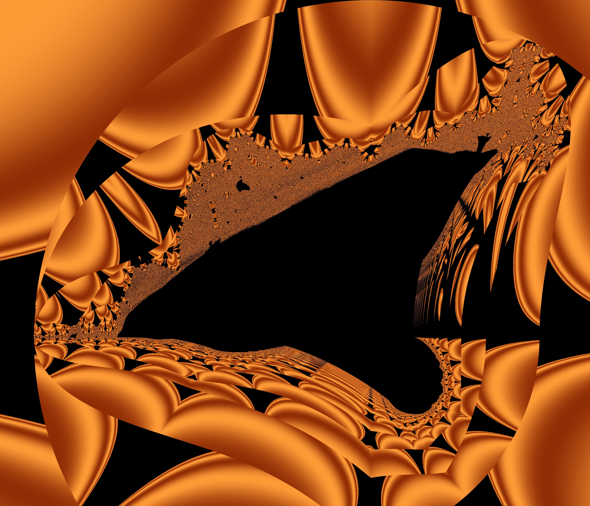

# Usage

## Running
To create the 35000x3000 image of the burning ship, just run the exe file:
```bash
.\burningShip.exe
```
This will create an output.bmp image with the fractal in the same directory

## Recompiling
To customize the width, height, or the maximum number of iterations, you can edit them in the `consts.h`

After editing, you can rerender the .bmp with
```bash
g++ main.cpp -O3 -march=native -ffast-math -fopenmp -o burningShip.exe && burningShip.exe
```
(The console logging may be a bit broken because it can use multiple CPU threads)


# Preview

